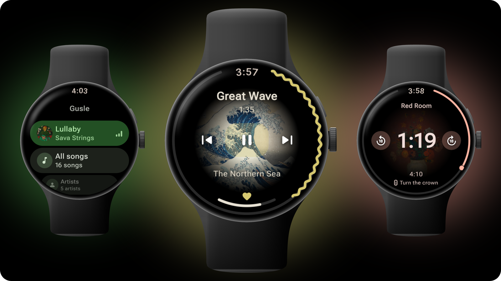
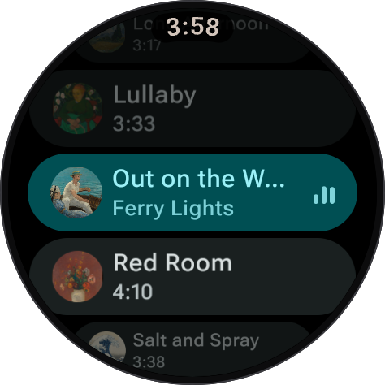
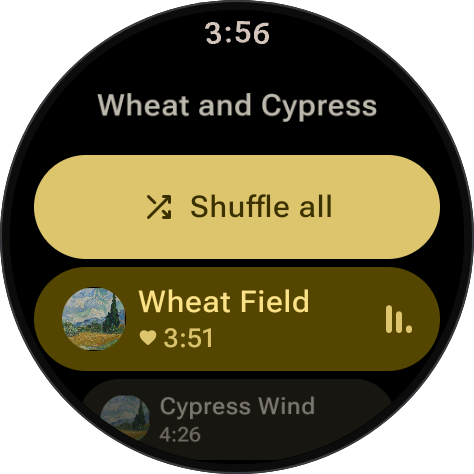
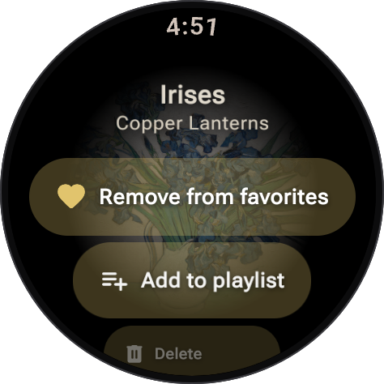
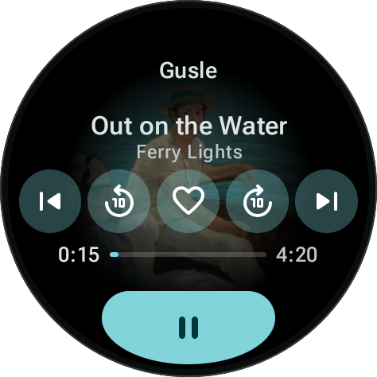
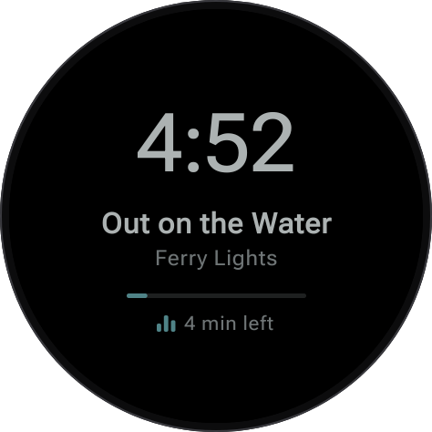
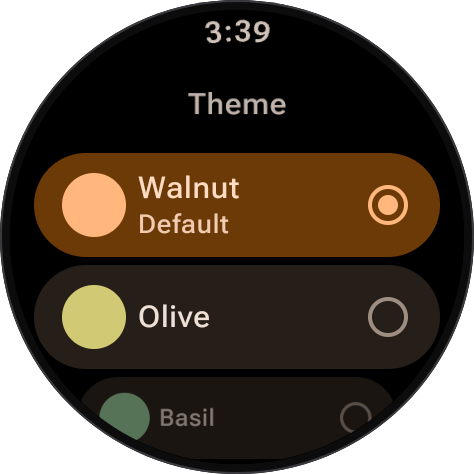
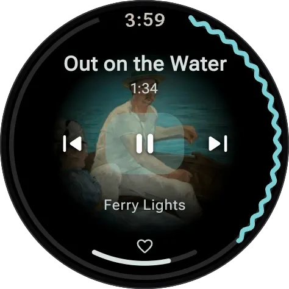
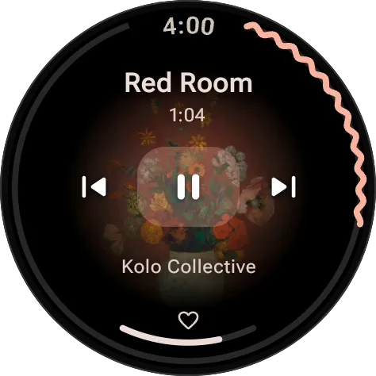

<p align="center">
  
</p>

<h1 align="center">Gusle</h1>

<p align="center">
  A local music player for Wear OS.<br>
  <sub>Wear OS 4 or newer · Round screens · No phone app · No internet permission</sub>
</p>

<p align="center">
  
</p>

## What it is

Gusle plays the music stored on your watch, through its speaker or Bluetooth headphones. It needs
no phone, no account and no internet: there's no phone app to install, and Gusle has no internet
permission, so it can't send anything off the watch. Now playing shows each song's cover in the
middle of the screen and takes its colors from it.

A gusle is the one-string bowed instrument of the Balkans, played to accompany epic songs; it's
what the icon shows.

## What it does

**Your music**

- All songs, Artists, Albums, Favorites and Playlists, read from the songs' own tags.
- Hold any song for its actions: add it to your favorites or a playlist, or delete it from the watch.
- Swipe a song's row to the left to add it to your favorites, or take it out.
- Playlists: make them, add songs (the same one twice, if you like), take songs out, rename, delete.

**Playing**

- Now playing has the cover in the middle and a ring around the edge that waves while the song
  plays. While a song plays, the lists take its cover's colors too.
- The crown changes the volume.
- Tap the time for the seek screen: the crown moves through the song, the buttons jump back or
  ahead.
- Swipe left for the Queue, with shuffle.
- The watch's media controls and your headphones' buttons work; Gusle pauses when the headphones
  disconnect.
- It picks up where you stopped, also after a restart, and skips a song it can't play.

**On the watch face**

- A tile: the song over its cover, play and pause, previous and next, jump back and ahead, and the
  heart.
- An always-on display: with your wrist down, the time, the song and the time left, dimmed.

**Settings**

- Six themes for when nothing is playing or a song has no cover. The app icon can follow the theme.
- How far the jump buttons go (5, 10 or 15 seconds) and how far each step of the crown seeks
  (1, 4 or 7 seconds).
- Rescan music, and Stop playing.

## Screenshots

<table>
  <tr>
    <td align="center" width="33%"><br>The Queue, a swipe away</td>
    <td align="center" width="33%"><br>An album</td>
    <td align="center" width="33%"><br>Hold a song for its actions</td>
  </tr>
  <tr>
    <td align="center" width="33%"><br>The tile</td>
    <td align="center" width="33%"><br>Always-on, with the wrist down</td>
    <td align="center" width="33%"><br>Six themes</td>
  </tr>
</table>

<table>
  <tr>
    <td align="center" width="50%"></td>
    <td align="center" width="50%"></td>
  </tr>
  <tr>
    <td align="center">The ring waves while a song plays. Next brings the new cover and its colors.</td>
    <td align="center">Tap the time, then turn the crown to move through the song.</td>
  </tr>
</table>

The covers in these pictures are public-domain paintings from the Metropolitan Museum of Art's Open
Access collection, by Hokusai, Van Gogh, Redon and Manet. The songs and artists are made up.

## Install

Gusle isn't on Google Play: you install it on the watch yourself, from your phone or a computer.
It needs Wear OS 4 or newer and a round screen. It's made on a OnePlus Watch 4 (Wear OS 6) and
tested there and on the Wear OS 6 emulator.

1. Download `gusle-<version>.apk` from the [Releases page](https://github.com/mrsharkula/gusle/releases).
2. Turn on developer options on the watch: in Settings, find **About** (under System; on some
   watches under Versions or Software) and tap **Build number** seven times.
3. In Settings → Developer options, turn on **ADB debugging** and **Wireless debugging**. The watch
   must be on the same Wi-Fi as your phone or computer.
4. Install the APK one of these ways:
   - **From your phone:** get **Wear Installer 2** from Google Play. On the watch, open Wireless
     debugging → Pair new device, and enter the IP address, port and pairing code it shows in
     Wear Installer 2. Then pick the APK and send it.
   - **From a computer** with Android's [platform tools](https://developer.android.com/tools/releases/platform-tools):

     ```sh
     adb pair <ip>:<pairing port>    # Pair new device's address; then its code
     adb connect <ip>:<port>         # the Wireless debugging screen's address
     adb install gusle-<version>.apk
     ```
5. Turn Wireless debugging off again when you're done.

If the watch doesn't show up, keep its screen on (on the charger, with the pairing screen open)
and turn its Bluetooth off for a moment, so it stays on Wi-Fi.

A newer version installs the same way, over the old one, and keeps your favorites and playlists.

## Music on the watch

Gusle plays the audio files saved on the watch; it doesn't copy music there. An app does that, for
example **Wear Files**, which sends songs from your phone to the watch. Gusle reads each song's
title, artist, album and cover from its tags; a song without tags shows its file name and goes
under Unknown artist and Unknown album.

Gusle finds what's there the next time it opens; if it doesn't, use Settings → Rescan music. If a
song you sent still doesn't show, restart the watch: Android sometimes finishes adding a file only
then.

## Build it yourself

Open the project in Android Studio and build it there, or from a terminal with `JAVA_HOME` set to a
JDK (Android Studio's own works; the build itself runs on JDK 21, which the project pins). For a
debug build:

```sh
./gradlew :app:assembleDebug    # the APK is in app/build/outputs/apk/debug/
./gradlew :app:installDebug     # onto every connected device
```

`installDebug` installs on every device adb sees, a phone too, so connect only the watch.

A release build is signed with your own key. Put a `keystore.properties` file in the project's
root folder; the build tells you when it's missing:

```properties
storeFile=/path/to/your-key.jks
storePassword=...
keyAlias=...
keyPassword=...
```

Then `scripts/install-release.sh [serial]` builds the release, installs it on the watch and applies
its baseline profile, so Gusle opens quickly. It needs Python 3 and a running adb server (Android
Studio's); without a serial it picks the first Wear OS device connected.

## Made with

[Jetpack Compose for Wear OS](https://developer.android.com/training/wearables/compose) (Material 3),
[Media3](https://developer.android.com/media/media3), [Navigation 3](https://developer.android.com/guide/navigation/navigation-3),
[Coil](https://coil-kt.github.io/coil/), [MaterialKolor](https://github.com/jordond/MaterialKolor),
[ProtoLayout and Tiles](https://developer.android.com/training/wearables/tiles) for the tile, and
[Material Symbols](https://fonts.google.com/icons) for the icons.

Media3, the player, adds two permissions of its own: one to keep the watch awake while it plays,
and one to see whether the watch is online. Neither lets anything leave the watch.

## License

Copyright © 2026 Miroljub Brkic

Gusle is free software, licensed under the [GNU General Public License, version 3](LICENSE). You may
use, study, change and share it; if you share it, changed or not, you must also share its source code
under the same license.
